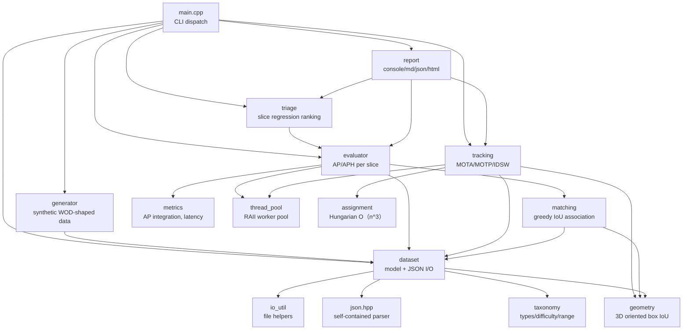
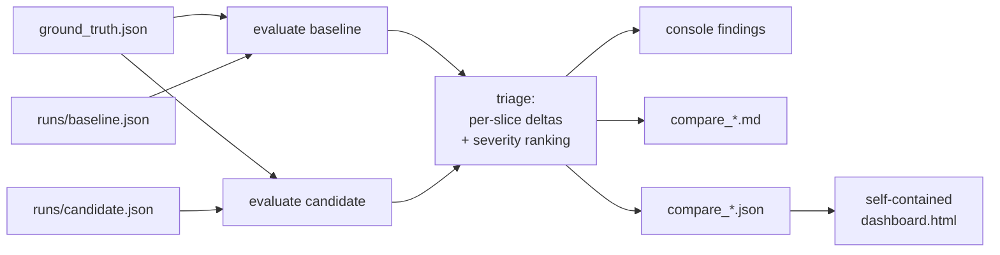

# Architecture

This document describes how the AV Perception Evaluation Platform (`pev`) is
wired together: the module dependency graph, the data-flow for each
subcommand, and the determinism model.

> Reminder: the bundled dataset is **synthetic and WOD-shaped**, produced by
> `pev generate`. It is not the real Waymo Open Dataset. The metrics and code
> are real. See `README.md` and `DESIGN.md`.

## Module dependency graph



## Layered view (ASCII)

```
+-------------------------------------------------------------+
| CLI (src/main.cpp): generate | evaluate | track | compare   |
|                     | dashboard                              |
+------------------------------+------------------------------+
                               |
        +----------------------+-----------------------+
        |              |               |               |
        v              v               v               v
  +-----------+  +-----------+   +-----------+   +-----------+
  | generator |  | evaluator |   | tracking  |   |  triage   |
  | (synth.)  |  | AP / APH  |   | CLEAR-MOT |   | slice rank|
  +-----+-----+  +-----+-----+   +-----+-----+   +-----+-----+
        |              |               |               |
        |        +-----+-----+   +-----+-----+         |
        |        | matching  |   | assignment|         |
        |        | (greedy)  |   | (Hungarian)|        |
        |        +-----+-----+   +-----+-----+         |
        |              |               |               |
        v              v               v               v
  +---------------------------------------------------------+
  |  dataset (model + JSON)   geometry (3D IoU)   taxonomy   |
  |  metrics (AP, latency)    thread_pool         io_util    |
  |  json.hpp (self-contained, no third-party deps)          |
  +---------------------------------------------------------+
                               |
                               v
                 +-----------------------------+
                 | report: console / md / json |
                 |         / self-contained html|
                 +-----------------------------+
```

## Data flow: `compare` (the headline path)



Each `evaluate` fans every scene out to the thread pool, matches detections to
ground truth per `{type}` with greedy highest-IoU association, labels each
detection TP/FP, and integrates AP/APH over the full
`{type} x {range bin} x {difficulty} x {scene tag}` slice cross-product. The
triage step diffs the baseline and candidate slice maps, scores each slice's
severity (recall and heading regressions weighted most, scaled by the log of
ground-truth support), ranks them, and flags regressions beyond the tolerances.

## Determinism model

The platform produces byte-identical reports for any thread count:

- Scenes are evaluated independently and their integer count contributions are
  summed; integer addition is associative and commutative, so merge order is
  irrelevant.
- AP/APH integration sorts detections by score (ties: true positives first) so
  the PR curve is independent of discovery order.
- Latency percentiles use nearest-rank on an internally-sorted copy.
- The synthetic generator is driven by a seeded `std::mt19937` with a per-frame
  seed derived from `(salt, scene, frame)`, so baseline and candidate draw the
  same random stream and diverge only where a regression is injected.

The `thread_count` is the only field in the emitted reports that varies with
the number of workers; everything else is identical (verified in the test
suite's determinism check and in `README.md`).
